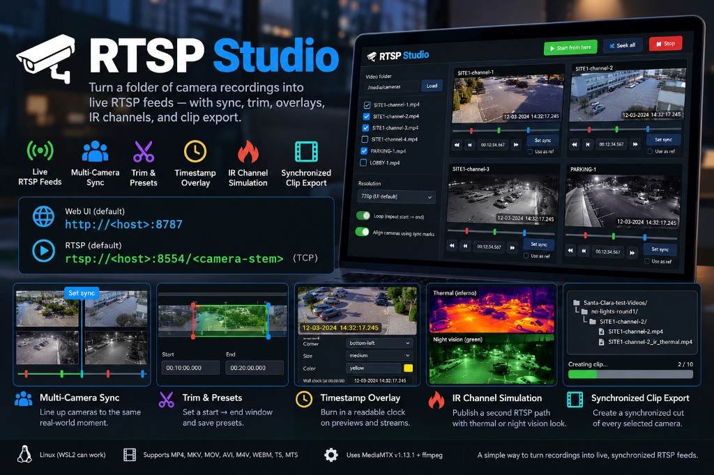

# RTSP Studio

[](https://www.apache.org/licenses/LICENSE-2.0)

<p align="center">
  
</p>

### Why RTSP Studio?

Developing and testing video AI applications often means working with hours of recorded footage, unsynchronized cameras, and manually clipping events—leading to repetitive FFmpeg scripts and custom tools.

**RTSP Studio eliminates that overhead.** Easily find events, synchronize multiple cameras, trim recordings, and replay them as live RTSP streams so you can **test your AI application end-to-end, just as it would run in production—without needing live cameras.** Export synchronized clips for AI model training and evaluation, all from a simple web interface.

**Less time preparing videos. More time building and testing AI.**

Publish a folder of multi-camera recordings as synchronized **RTSP** feeds from one Linux host.

Load the folder in the web UI, mark the same real-world moment on each camera, trim start→end, then Start. Optional timestamp overlay, simulated IR as a second path per camera, named presets, and synchronized clip export.

| | |
| --- | --- |
| UI | `http://<host>:8787` |
| RTSP | `rtsp://<host>:8554/<camera-stem>` over **TCP** |
| Control | Start/Stop from any browser; publishers always run on the host |

Full feature list: [FEATURES.md](FEATURES.md) · Responsible use: [DISCLAIMER.md](DISCLAIMER.md)

---

## Requirements

- Linux (x86_64, arm64, armv7, or armv6). WSL2 can work. There is **no native Windows build**.
- Python **3.10+**
- **ffmpeg** and **ffprobe** with libx264 (scale/overlay/IR) and drawtext (timestamp overlay)
- A monospace TTF (DejaVu Sans Mono, Liberation Mono, or FreeMono) for overlays
- Network access once to download [MediaMTX](https://github.com/bluenviron/mediamtx) v1.13.1 (vendored into `vendor/mediamtx`)

`install.sh` installs the OS packages it can and fetches MediaMTX.

---

## Install

```bash
git clone https://github.com/<you>/rtsp-studio.git
cd rtsp-studio
chmod +x install.sh start.sh stop.sh ui.py
./install.sh
```

`install.sh` will:

1. Install `python3`, `ffmpeg`, overlay fonts, `curl`, and related tools via `apt`, `dnf`, `yum`, `pacman`, or `brew` (needs sudo/root unless everything is already present).
2. Download MediaMTX **v1.13.1** into `./vendor/mediamtx` (or copy it from `~/Downloads/mediamtx_v1.13.1_<os>_<arch>/` if you already have the release).
3. Check that `python3`, `ffmpeg`/`ffprobe`, and the MediaMTX binary are usable.

### Options

```bash
./install.sh --skip-packages          # only fetch MediaMTX; you already have python/ffmpeg/fonts
MEDIAMTX_VERSION=1.13.1 ./install.sh  # override the MediaMTX release tag
```

If you have no supported package manager, install Python 3.10+, ffmpeg, ffprobe, and DejaVu Sans Mono yourself, then re-run with `--skip-packages`.

### Manual packages (Debian/Ubuntu)

```bash
sudo apt-get update
sudo apt-get install -y python3 ffmpeg fonts-dejavu-core curl ca-certificates iproute2 tar gzip
./install.sh --skip-packages
```

---

## Run

On the **machine that should publish RTSP**:

```bash
python3 ui.py
```

The process prints both localhost and LAN URLs, for example:

```
RTSP Studio: http://127.0.0.1:8787
         http://192.168.1.44:8787
```

Open that URL from this machine or another on the LAN. Load a video folder, select cameras, set sync and trim, then **Start from here**.

Stop the UI with Ctrl+C. Use **Stop** in the web UI (or `./stop.sh`) to tear down ffmpeg and MediaMTX.

### Environment

| Variable | Default | Meaning |
| --- | --- | --- |
| `UI_HOST` | `0.0.0.0` | Address the web UI binds |
| `UI_PORT` | `8787` | Web UI port |
| `RTSP_PORT` | `8554` | MediaMTX RTSP port |
| `RTSP_BIND` | `127.0.0.1` | Address ffmpeg publishes to (MediaMTX listens on all interfaces) |
| `MEDIAMTX_BIN` | `vendor/mediamtx/mediamtx` | MediaMTX binary |

```bash
UI_PORT=9087 python3 ui.py
```

---

## First session

1. **Load folder** — non-recursive; `.mp4` `.mkv` `.mov` `.avi` `.m4v` `.webm` `.ts` `.mts`.
2. Check the cameras to publish. The ref camera does **not** have to be selected.
3. On each camera, scrub or type `HH:MM:SS.mmm` at the same real-world event → **Set sync**. **Use as ref** on one camera.
4. Turn on **Align cameras using sync marks**. Set **Start** and **End** (or load a preset).
5. Optional: timestamp overlay, **Publish IR**, resolution (UI default **720p**; Original 4K-copies when it can).
6. **Start from here**. Copy the LAN URLs. In VLC use TCP: extra option `:rtsp-tcp`.
7. **Create clip** writes `<folder>/<preset>/<camera>/<camera>.mp4` (and `_ir_thermal.mp4` if IR is on). Name or load a preset first.

While streams are running, most edit controls lock. **Seek all** restarts the same window; **Jitter** stops for N seconds and starts again.

---

## Play the streams

Paths are the file stem. IR is the same stem with `_ir`:

```
rtsp://192.168.1.44:8554/SITE1-channel-2
rtsp://192.168.1.44:8554/SITE1-channel-2_ir
```

Use **RTSP over TCP**. 4K H.264 keyframes are shredded by UDP RTP fragmentation (connected stream, no picture).

VLC:

```
vlc --rtsp-tcp rtsp://192.168.1.44:8554/SITE1-channel-2
```

---

## Command line (no browser)

```bash
./start.sh /path/to/videos --res 720 --offset 90 --end 180 \
  --only SITE1-channel-2.mp4 \
  --mark SITE1-channel-2.mp4=120.5 --ref SITE1-channel-2.mp4 \
  --overlay --ir --ir-style thermal

./stop.sh
```

`./start.sh --help` lists overlay, IR, loop, and mark options.

---

## Layout

```
rtsp-studio/
  install.sh          # OS packages + MediaMTX
  ui.py               # web UI (port 8787)
  ui/index.html
  start.sh / stop.sh  # MediaMTX + ffmpeg publishers
  mediamtx.yml
  FEATURES.md
  DISCLAIMER.md       # responsible use
  LICENSE             # Apache License 2.0
  NOTICE              # copyright and third-party attribution
  docs/banner.jpg     # GitHub README banner
  vendor/mediamtx/    # created by install.sh (gitignored)
  .rtsp-state/        # live PIDs and session (gitignored)
```

Per video folder (created at runtime, not in git):

- `rtsp-sync.txt` — sync marks and ref
- `rtsp-presets.json` — named start/end windows
- `<preset>/<camera>/` — exported clips

---

## Notes

- Overlay and IR **encode**. Original resolution **copies** color 4K unless overlay/scale is on. IR is 720p when color is Original.
- IR is a heatmap / night-vision **look** from visible-light video, not radiometric thermal.
- The UI session is shared across browsers on the same host. Sync marks **merge**; they are not replaced by a partial save from another tab.
- ffmpeg restarters keep a feed up if a single process exits; **Stop** ends the whole set.

---

## License

RTSP Studio original source is licensed under the [Apache License 2.0](LICENSE). You may use it privately or commercially, modify it, redistribute it, and include it in other projects. The license includes an express patent grant. Keep the license and attribution notices. You do not have to publish source for your modifications.

Copyright for this original code remains with the author.

Third-party programs this project **runs** (not ships in git) keep their own licenses. See [NOTICE](NOTICE):

| Component | License | How it is used |
| --- | --- | --- |
| [MediaMTX](https://github.com/bluenviron/mediamtx) | MIT | Downloaded by `install.sh` into `vendor/mediamtx` |
| [FFmpeg](https://ffmpeg.org/) | LGPL 2.1+ or GPL 2+ (build-dependent) | External `ffmpeg` / `ffprobe` processes |
| libx264 | GPL-2.0-or-later | Used by ffmpeg when encoding overlay, scale, or IR |
| Python 3 | PSF | Interpreter |
| DejaVu / similar fonts | Font package licenses | drawtext overlay |

When you create the GitHub repository, set the repository license to **Apache-2.0**. GitHub will also detect it from the `LICENSE` file.

Read [DISCLAIMER.md](DISCLAIMER.md) before using or redistributing RTSP Studio. It covers intended use, privacy, simulated IR, operational risk, and third-party components. This disclaimer does not change the Apache License 2.0.
